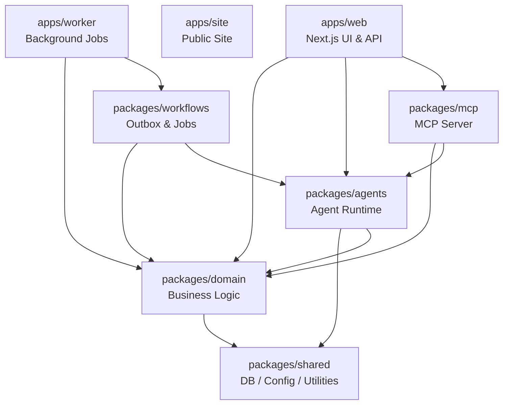

Corgtex is built as an enterprise-grade monorepo using Next.js, React, TypeScript, and Prisma. Shared packages provide business logic and infrastructure services, while the worker handles queued background processing separately from web requests.

## The runtime split

Corgtex has three applications (inside `apps/`):

1. **`apps/web` (Next.js)**: Serves the user interface, API routes, and MCP endpoints. Handles synchronous user requests, Next.js App Router rendering, immediate data mutations, and interactive agent conversations.
2. **`apps/worker` (Node.js)**: Dispatches transactional outbox events and processes queued jobs through `@corgtex/workflows`, including document indexing and background agents. Supports continuous, queue-only, and one-shot scheduler modes.
3. **`apps/site` (Next.js)**: Serves the public marketing website and forwards demo requests to the web API.

The diagram shows selected package imports:

## Packages

The core logic resides in `packages/`. This allows both the Web app and Worker app to safely share implementations.

*   **`@corgtex/shared`**: Shared Prisma client access, centralized environment variable parsing, actor and membership types, and common infrastructure utilities.
*   **`@corgtex/domain`**: Core business rules for governance, workspace data, authentication, and access control, plus application errors. Shared by the web app and background workflows without importing Next.js.
*   **`@corgtex/agents`**: Application-specific agents and interactive conversations, with tool execution and agent run tracking. Uses the domain, knowledge, and model gateway packages.
*   **`@corgtex/knowledge`**: Manages Organization Brain file ingestion, text extraction, chunking, embeddings, and retrieval. Supports PostgreSQL-backed lexical and semantic ranking and optional Azure AI Search.
*   **`@corgtex/models`**: A neutral gateway layer for LLM providers (OpenAI, OpenRouter, etc.). Keeps the rest of the application decoupled from specific vendor SDKs.
*   **`@corgtex/workflows`**: Transactional outbox dispatch, queued job processing, retries, handler routing, and scheduling used by `apps/worker`.
*   **`@corgtex/connectors-sql`**: Read-only PostgreSQL connections and cursor-based row ingestion into knowledge indexing.
*   **`@corgtex/storage`**: File abstraction layer for uploads, downloads, and signed URLs using S3-compatible storage or Azure Blob Storage.
*   **`@corgtex/mcp`**: Authenticated MCP server exposing Corgtex tools and resources through the web app, backed by domain, knowledge, and agent implementations.

## Tech Stack

*   **Framework**: Next.js 15 (App Router), React 19
*   **Language**: TypeScript (strict mode)
*   **Styling**: Tailwind CSS 3
*   **Database**: PostgreSQL
*   **ORM**: Prisma
*   **Knowledge Search**: PostgreSQL-backed lexical and semantic ranking, or Azure AI Search. The schema includes a `pgvector` column prepared for vector queries.
